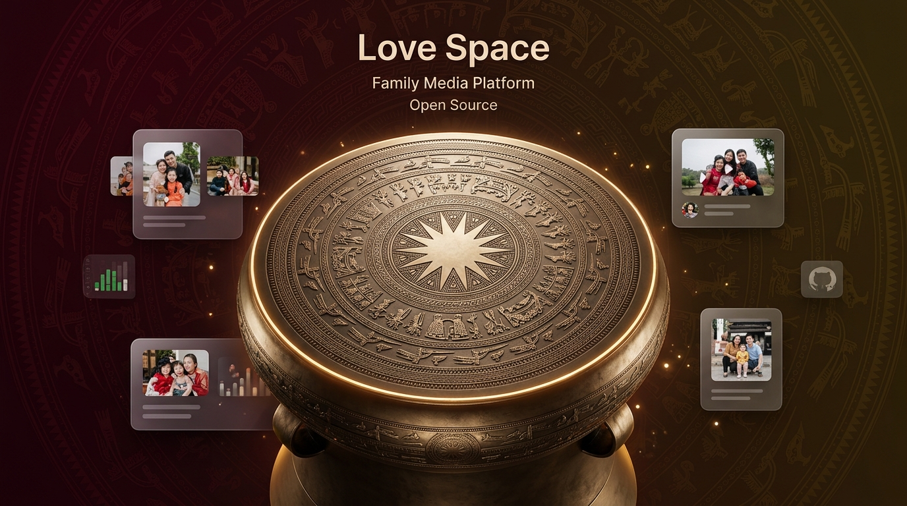
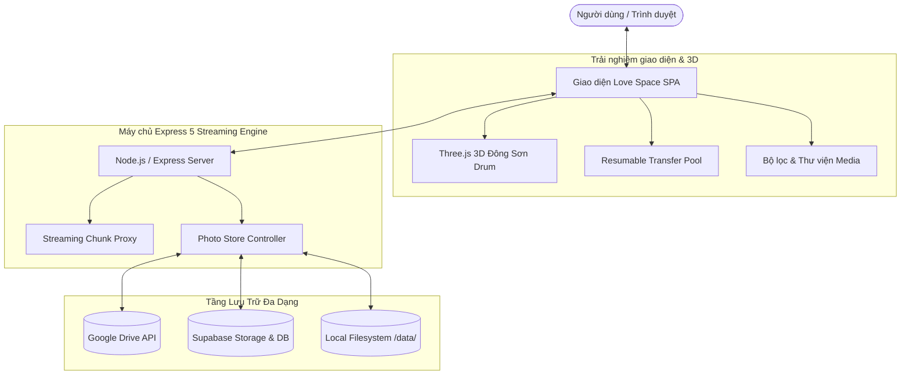

# 🪘 Love Space · Không Gian Lưu Trữ Kỷ Niệm Gia Đình

<div align="center">



**Nền tảng lưu trữ ảnh và video gia đình độc đáo với mô hình 3D Mặt Trống Đồng Đông Sơn Three.js**  
*Tôn vinh bản sắc văn hóa Việt · Lưu giữ trọn vẹn từng khoảnh khắc yêu thương*

[](https://nodejs.org)
[](https://threejs.org)
[](https://expressjs.com)
[](https://cloud.google.com/drive)
[](https://supabase.com)
[](LICENSE)

[Tính năng nổi bật](#-tính-năng-nổi-bật) • [Mặt trống đồng 3D](#-nghệ-thuật-3d-trống-đồng-đông-sơn) • [Kiến trúc hệ thống](#-kiến-trúc-hệ-thống) • [Hướng dẫn cài đặt](#-hướng-dẫn-cài-đặt) • [Triển khai đám mây](#-triển-khai-đám-mây)

</div>

---

## 🌟 Giới thiệu tổng quan

**Love Space** là một dự án mã nguồn mở khác biệt: Không chỉ là một kho lưu trữ đám mây thuần túy, Love Space được thiết kế như một **bảo tàng ký ức gia đình** mang đậm phong vị văn hóa Việt Nam.

Trung tâm của không gian là mô hình **3D Mặt Trống Đồng Đông Sơn** được tạo tác tỉ mỉ bằng Three.js, xoay chuyển sống động theo thời gian thực và tương tác mượt mà với người dùng. Toàn bộ trải nghiệm được chăm chút để mọi thành viên trong gia đình — từ trẻ nhỏ đến ông bà cao tuổi — đều có thể dễ dàng sử dụng và tìm thấy niềm vui khi xem lại những thước phim, bức ảnh quý giá.

---

## ✨ Tính năng nổi bật

### 🪘 Nghệ thuật 3D Trống Đồng Đông Sơn
- **Dựng hình Procedural thuần túy**: Toàn bộ hoa văn được kết xuất động bằng HTML5 Canvas Texture (`drum-face.js`) kết hợp Three.js WebGL shader (`drum3d.js`), không phụ thuộc vào các tệp 3D asset nặng nề.
- **Họa tiết chuẩn cổ học**: Tái hiện sinh động mặt trời 14 tia sáng ở tâm, đàn chim Lạc bay ngược chiều kim đồng hồ, các vành đồng tâm với hình vũ sinh tế lễ, hoa văn răng cưa, hình chấm dải và hồi văn truyền thống.
- **Hiệu ứng vật lý & Ánh kim chân thực**: Tương tác xoay đĩa 3D bằng cảm ứng/chuột với quán tính mượt mà, ánh kim đồng cổ phong hóa (patina), bóng đổ nổi khối dập nổi (relief bump mapping).
- **Celebration Mode**: Hiệu ứng xoay gia tốc và rung chuyển lễ hội khi gia đình tải lên thành công những bộ ảnh mới.
- **Thân thiện hiệu năng**: Tự động giảm chất lượng trên màn hình nhỏ hoặc rơi về ảnh fallback tĩnh khi thiết bị bật chế độ giảm chuyển động (`prefers-reduced-motion`).

### ☁️ Kiến trúc lưu trữ lai (Hybrid Storage)
- **Google Drive Streamer (Resumable Chunks)**:
  - Tải lên trực tiếp qua phiên có thể nối tiếp (Resumable Upload Session), phân mảnh 8 MB mượt mà.
  - Hỗ trợ tải các tệp video siêu lớn lên tới **10 GB** mà không tràn bộ nhớ RAM máy chủ.
  - Cơ chế **Safe Trash**: Khi bấm xóa trên web, tệp được chuyển vào Thùng rác Google Drive (lưu trữ 30 ngày) thay vì xóa vĩnh viễn, cho phép hoàn tác bất kỳ lúc nào.
- **Supabase Cloud Vault**:
  - Hỗ trợ lưu trữ siêu dữ liệu (metadata), phân trang ngày chụp và phân vùng Object Storage an toàn.
  - Đi kèm hàm SQL RPC tính toán và bộ đếm lượt truy cập gia đình tối ưu.
- **Local Fallback**:
  - Sẵn sàng chạy offline độc lập với bộ nhớ đĩa cục bộ (`data/uploads`) khi không cần dịch vụ ngoài.

### 👨‍👩‍👧‍👦 Thiết kế thân thiện cho mọi thế hệ (Universal Family UX)
- **Cảm hứng Cung đình Việt**: Bảng màu đỏ trầm chu sa hoàng tộc, hoa văn lụa gấm sen mây cổ truyền kết hợp font chữ thư pháp *Dancing Script*.
- **Tối ưu cho người lớn tuổi**:
  - Nút **A+** một chạm phóng to toàn bộ kích thước chữ và giao diện.
  - **Đồng hồ thời gian thực song hành Âm lịch**: Nhắc nhớ ngày giỗ chạp, lễ Tết cổ truyền của gia đình.
- **Bảo toàn 100% chất lượng gốc**: Ảnh và video tải về được giữ nguyên vẹn từng byte dữ liệu (EXIF, metadata, bitrate nguyên bản).
- **Bộ công cụ quản lý trực quan**: Lọc theo ngày, tìm kiếm tức thì, đổi ngày chụp hàng loạt, xem trước media với trình chiếu chuyên dụng.

---

## 🏛️ Kiến trúc hệ thống



---

## 🚀 Hướng dẫn cài đặt & Khởi chạy

### Yêu cầu hệ thống
- **Node.js**: Phiên bản `>= 20.0.0`
- **Trình duyệt**: Hỗ trợ WebGL (Chrome, Edge, Safari, Firefox)

### 1. Tải mã nguồn & Cài đặt
```bash
git clone https://github.com/thanhduykx/love-space-dongson.git
cd love-space-dongson
npm ci
```

### 2. Chạy kiểm thử tự động
Dự án đi kèm bộ kiểm thử toàn diện với test runner chuẩn của Node.js:
```bash
npm test
```

### 3. Khởi chạy môi trường phát triển
```bash
npm start
```
Mở trình duyệt tại: [http://localhost:3000](http://localhost:3000).  
Mặc định hệ thống sẽ chạy ở chế độ cục bộ, lưu ảnh vào `data/uploads`.

---

## ⚙️ Cấu hình môi trường (.env)

Sao chép tệp mẫu để thiết lập cấu hình:
```bash
cp .env.example .env
```

| Biến môi trường | Ý nghĩa | Mặc định |
|---|---|---|
| `PORT` | Cổng HTTP lắng nghe của máy chủ | `3000` |
| `CANONICAL_HOST` | Tên miền chính (tự chuyển hướng 301 nếu truy cập domain khác) | *Trống* |
| `SUPABASE_URL` | URL kết nối dự án Supabase | *Trống* |
| `SUPABASE_SECRET_KEY` | Service Role Secret Key của Supabase | *Trống* |
| `GOOGLE_DRIVE_FOLDER_ID` | Mã ID thư mục Google Drive lưu trữ media | *Trống* |
| `GOOGLE_DRIVE_OAUTH_CLIENT_ID` | OAuth Client ID (Drive cá nhân) | *Trống* |
| `GOOGLE_DRIVE_OAUTH_CLIENT_SECRET` | OAuth Client Secret (Drive cá nhân) | *Trống* |
| `GOOGLE_DRIVE_OAUTH_REFRESH_TOKEN` | Refresh Token sinh ra từ lệnh `npm run drive:auth` | *Trống* |
| `GOOGLE_DRIVE_SERVICE_ACCOUNT_JSON` | Khóa JSON tài khoản dịch vụ (Shared Drive) | *Trống* |

---

## ☁️ Triển khai đám mây

### A. Triển khai lên Render (1-Click Blueprint)
Dự án có sẵn tệp `render.yaml` chuẩn:
1. Đẩy mã nguồn lên kho Git của bạn.
2. Trên [Render Dashboard](https://dashboard.render.com), chọn **New +** → **Blueprint** và trỏ tới repository.
3. Thiết lập các biến bí mật (`SUPABASE_URL`, `SUPABASE_SECRET_KEY`, v.v.) trong phần Environment Settings.
4. Render sẽ tự động dựng và kích hoạt Web Service.

### B. Thiết lập cơ sở dữ liệu Supabase
1. Vào SQL Editor trên Dashboard của Supabase.
2. Lần lượt chạy các tệp script trong thư mục `supabase/`:
   - `supabase/setup.sql`: Khởi tạo bảng dữ liệu và cấu hình lưu trữ ban đầu.
   - `supabase/media-upgrade.sql`: Nâng cấp hỗ trợ tệp đa phương tiện kích thước lớn.
   - `supabase/delete-photos.sql`: Các hàm bảo đảm tính toàn vẹn khi xóa ảnh.
   - `supabase/visit-counter.sql`: Bộ đếm lượt xem trang bảo mật.
   - `supabase/keepalive.sql`: Thiết lập cron job tự động ping để duy trì máy chủ miễn phí không bị sleep.

### C. Kết nối Google Drive cá nhân (OAuth 2.0)
1. Trên **Google Cloud Console**, tạo một dự án mới và bật **Google Drive API**.
2. Cấu hình **OAuth consent screen** (chọn loại External, thêm email của bạn vào danh sách Test users).
3. Tạo **Credentials** → **OAuth client ID** với loại ứng dụng là **Desktop app**.
4. Chạy công cụ xác thực tích hợp sẵn:
   ```bash
   npm run drive:auth -- path/to/client_secret.json
   ```
5. Đăng nhập qua liên kết được tạo và cấp quyền. Refresh token sẽ được tự động ghi an toàn vào `.env`.
6. Kiểm tra lại kết nối:
   ```bash
   npm run drive:check
   ```

---

## 🛡️ Quyền riêng tư & Bảo mật
- **Không lưu dữ liệu nhạy cảm**: Dự án cung cấp `.gitignore` chuẩn hóa, không lưu thông tin đăng nhập, token hay khóa bí mật vào kho mã nguồn.
- **Zero Tracker**: 100% không chứa mã phân tích, theo dõi người dùng hay quảng cáo từ bên thứ ba.
- **Bảo vệ gia đình**: Quyền riêng tư của các thành viên gia đình là ưu tiên cao nhất. Dữ liệu chỉ chia sẻ qua đường dẫn bí mật của chính bạn.

---

## 🤝 Đóng góp & Giấy phép

Mọi đóng góp, ý kiến xây dựng và Pull Request đều được hoan nghênh nồng nhiệt!
- Mở **Issue** nếu bạn phát hiện lỗi hoặc muốn đề xuất tính năng mới.
- Dự án được phát hành dưới giấy phép [MIT License](LICENSE).

<div align="center">
  <sub>Được phát triển với niềm đam mê công nghệ và lòng tự hào văn hóa Việt Nam 🇻🇳</sub>
</div>
